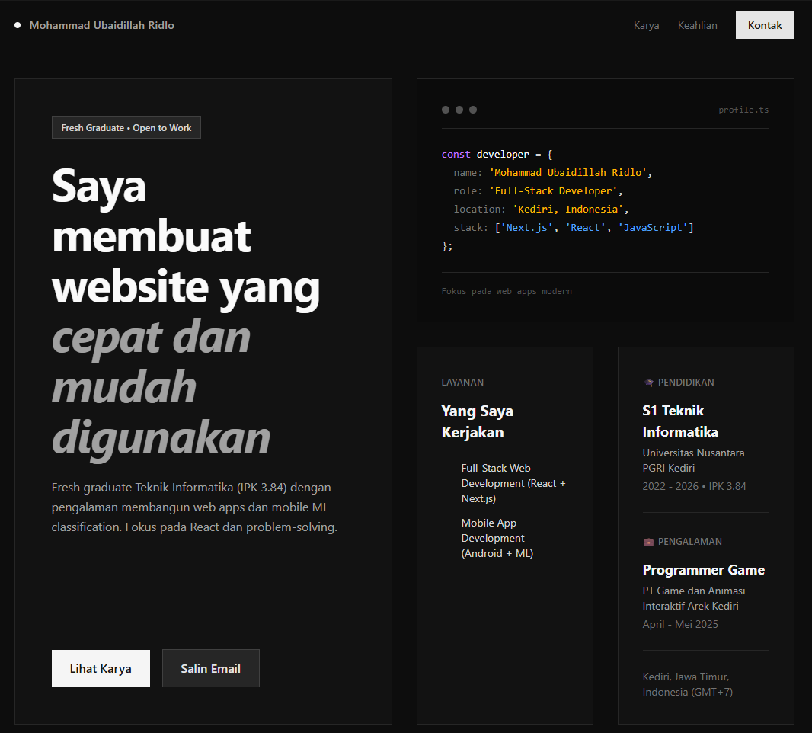

# Portfolio Website — Mohammad Ubaidillah Ridlo



Modern portfolio website showcasing my projects, skills, and professional experience as a Full-Stack Developer. Built with Next.js 16, React 19, TypeScript, and Tailwind CSS.

🔗 **Live Demo:** [Your deployed URL here]

---

## 🚀 Features

- **Responsive Bento Grid Layout** — Adaptive card-based design
- **Project Showcase** — Live demos and source code for key projects
- **Interactive UI** — Copy email, smooth scrolling, hover effects
- **CV Download** — One-click resume download
- **SEO Optimized** — Proper metadata and OpenGraph tags
- **Modern Tech Stack** — Next.js App Router, TypeScript, Tailwind CSS

---

## 🛠️ Tech Stack

**Frontend:**
- Next.js 16 (App Router)
- React 19
- TypeScript
- Tailwind CSS v4

**Tools:**
- Git / GitHub
- ESLint
- PostCSS

---

## 📂 Project Structure

```
my-portofolio/
├── app/                 # Next.js App Router
│   ├── layout.tsx      # Root layout & metadata
│   ├── page.tsx        # Homepage
│   └── globals.css     # Global styles
├── components/          
│   └── cards/          # Reusable card components
├── data/
│   └── portfolioData.ts # Centralized portfolio content
├── public/             # Static assets (images, CV, icons)
└── README.md
```

---

## 🏃 Local Development

**Prerequisites:**
- Node.js 20+ 
- npm / yarn / pnpm / bun

**Setup:**

```bash
# Clone repository
git clone https://github.com/R12DLO45/my-portofolio.git
cd my-portofolio

# Install dependencies
npm install

# Run development server
npm run dev

# Open http://localhost:3000
```

**Build for production:**
```bash
npm run build
npm start
```

---

## 📝 Content Management

All portfolio content (projects, tech stack, personal info) is centralized in `data/portfolioData.ts`. Edit this file to update:

- Personal information & bio
- Projects & descriptions
- Tech stack & skills
- Education & experience
- Social links

---

## 📧 Contact

**Mohammad Ubaidillah Ridlo**  
📍 Kediri, Jawa Timur, Indonesia  
📧 ubaidillahridlo57@gmail.com  
🔗 [LinkedIn](https://www.linkedin.com/in/mohammad-ubaidillah-ridlo) • [GitHub](https://github.com/R12DLO45)

---

## 📄 License

This project is open source for educational purposes. Feel free to fork and customize for your own portfolio.

---

**Fresh Graduate • S1 Teknik Informatika • IPK 3.84 • Open to Work**
